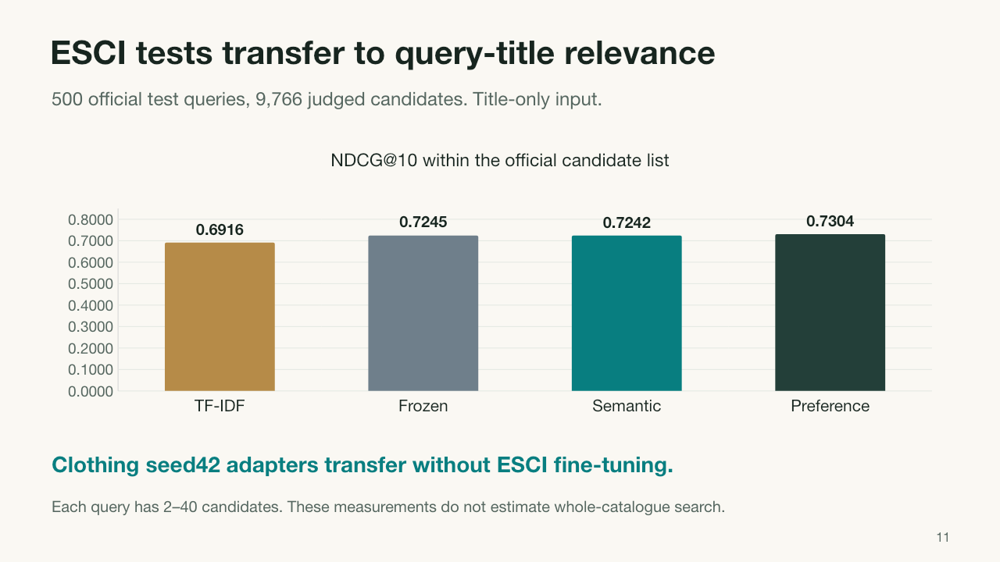
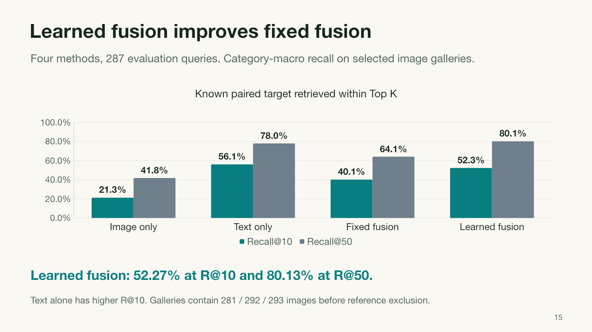
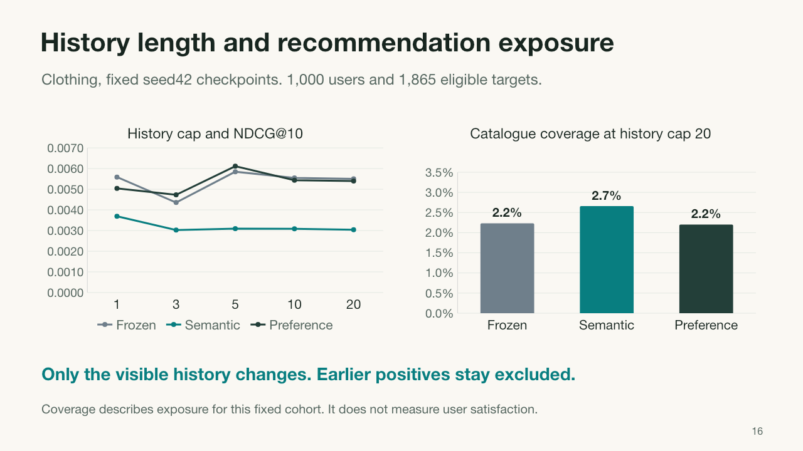
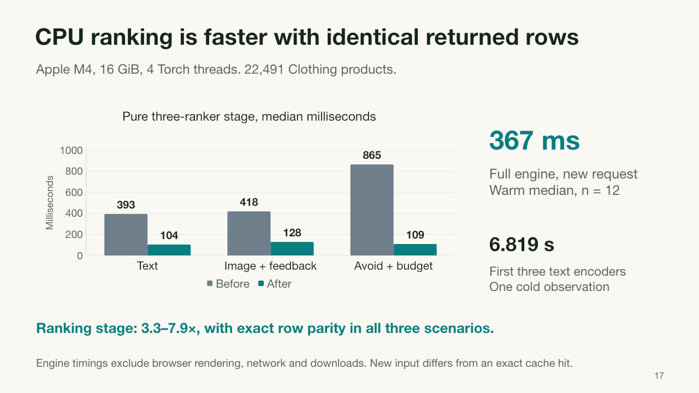

# ShopLens: multimodal shopping and automatic benchmark evidence

## Study overview

ShopLens compares three ways of using Qwen text embeddings for multimodal product recommendation: a frozen text encoder, semantic alignment with LoRA, and preference ranking with LoRA. The saved historical audit reports **27 complete formal records and zero audit errors**: three Amazon 2014 product domains × three objectives × three independently repeated pipeline seeds (42, 43 and 44).

**Frozen has the highest mean held-out NDCG@10 in all three domains.** The recorded study does not establish a consistent improvement from either LoRA objective. Preference training is generally closer to Frozen than semantic alignment, while several individual paired seeds reverse the mean ordering. These descriptive results are reported without a statistical-significance or online-performance claim.

The application exposes the historical experiment through Experiment gallery and makes current shopping recommendations inspectable through Model arena. A separate **automatic benchmark extension** now adds labeled ESCI search, FashionIQ image + language retrieval, same-case recommendation diagnostics and local inference profiling. The extension trains one lightweight FashionIQ fusion model; it does not retrain or replace the original 27 Qwen pipelines. Shopping Studio remains a separate exploratory free-text interaction.

The original three domains come from the **same Amazon 2014 source**. The extension adds **two independently sourced datasets, Amazon ESCI and FashionIQ**, for three sources overall. Their tasks, candidate sets and metrics remain separate. The prepared Amazon 2014 interactive catalog contains 47,801 products: Baby 7,037; Sports & Outdoors 18,273; Clothing & Accessories 22,491.

## Formal method and protocol

### Encoders and controlled objectives

The text model is `Qwen/Qwen3-Embedding-0.6B`, pinned to revision `97b0c614be4d77ee51c0cef4e5f07c00f9eb65b3`. Encoding uses at most 256 tokens, left padding, last-valid-token pooling and L2 normalization, with identical training/export truncation. Candidate descriptions receive no query instruction. Trainable candidates use LoRA rank 8, alpha 16 and dropout 0.05 on `q_proj` and `v_proj`. The recommendation head has 128 dimensions.

The primary contrast is an **asymmetric two-tower experiment**. Histories always use frozen base-Qwen text plus the original fixed CLIP features. Only the candidate text tower changes: frozen Qwen, semantic LoRA or preference LoRA. Candidate features must not replace history features.

| Objective | Candidate text encoder | Adaptation signal | What remains controlled |
|---|---|---|---|
| Frozen | Frozen base Qwen | BPR trains the recommendation head; Qwen weights stay fixed | Frozen history text, fixed CLIP features, head architecture and evaluation protocol |
| Semantic alignment | Qwen + LoRA | Multi-positive InfoNCE aligns review anchors with candidate descriptions; BPR text input is detached so BPR trains the head | Same warmup head, sampled cases, order and negatives within domain/seed |
| User preference | Qwen + LoRA | BPR gradients update the candidate LoRA parameters directly as well as the head | Same warmup head, sampled cases, order and negatives within domain/seed |

Target reviews never enter recommendation-history queries. Semantic anchors use frozen base-Qwen review embeddings; candidate descriptions are encoded live during adaptation. The Frozen label refers to the text encoder, **not an untrained recommendation head**.

### Seeds, budgets and checkpoint selection

Each complete pipeline is repeated independently for seeds 42, 43 and 44. Within a domain/seed, all objectives share the selected full-input warmup head, the same sampled behavioral cases and order, and the same negative arrays. Adaptation uses up to 30,000 eligible TRAIN cases with exactly matched positive reviews, over two epochs.

Adaptation epoch 1 or 2 is selected using full-catalog downstream **validation NDCG@10**. Epoch 0 and held-out test scores cannot select a checkpoint. All groups retain the established temporal split, prior-item exclusions, eligible candidate catalog and user-macro evaluation protocol. The principal reported contrast is among these three Qwen objectives under the declared budget.

Legacy MiniLM baselines used a fixed five-epoch main-ranker budget and one shared adaptation seed. Qwen uses a separately declared warmup of up to 20 epochs plus sampled adaptation and full-pipeline seeds. Differences against legacy tables therefore mix model, budget and sampling changes; they are not an isolated estimate of the LoRA objective effect. Existing baseline reports and artifacts remain separate from this comparison.

## Held-out test metrics

Means and **sample standard deviations** across the three pipeline seeds are shown in original metric units. Domains are kept separate; no cross-domain mean is used. A sample SD describes observed seed variation and is neither a confidence interval nor a significance test.

| Domain | Objective | Seeds | Recall@10 | NDCG@10 | Recall@20 | NDCG@20 |
|---|---|---:|---:|---:|---:|---:|
| baby | qwen_frozen | 3 | 0.027412 ± 0.002656 | 0.012796 ± 0.000959 | 0.042491 ± 0.001817 | 0.016589 ± 0.001039 |
| baby | qwen_preference | 3 | 0.026099 ± 0.002937 | 0.012475 ± 0.000849 | 0.041547 ± 0.002861 | 0.016357 ± 0.000882 |
| baby | qwen_semantic | 3 | 0.019995 ± 0.001775 | 0.009930 ± 0.000728 | 0.032398 ± 0.002454 | 0.013070 ± 0.000873 |
| clothing | qwen_frozen | 3 | 0.010730 ± 0.000846 | 0.005186 ± 0.000562 | 0.018709 ± 0.000847 | 0.007190 ± 0.000585 |
| clothing | qwen_preference | 3 | 0.010476 ± 0.000572 | 0.005124 ± 0.000463 | 0.018854 ± 0.000463 | 0.007227 ± 0.000375 |
| clothing | qwen_semantic | 3 | 0.009161 ± 0.000485 | 0.004460 ± 0.000384 | 0.014435 ± 0.001244 | 0.005788 ± 0.000536 |
| sports | qwen_frozen | 3 | 0.014565 ± 0.000848 | 0.007116 ± 0.000684 | 0.024839 ± 0.001840 | 0.009697 ± 0.000946 |
| sports | qwen_preference | 3 | 0.014429 ± 0.000688 | 0.007039 ± 0.000584 | 0.024675 ± 0.002447 | 0.009606 ± 0.001005 |
| sports | qwen_semantic | 3 | 0.013297 ± 0.001257 | 0.006872 ± 0.000613 | 0.020772 ± 0.001763 | 0.008745 ± 0.000547 |

## Same-seed paired changes

Differences are computed between objectives using the **same complete pipeline seed** within each domain. The public summary records paired NDCG@10 differences directly; it does not contain seed-specific absolute test scores from which to reconstruct additional test-metric distributions.

| Domain | After − before | Seeds | ΔNDCG@10 mean ± SD | Wins / ties / losses |
|---|---|---|---:|---:|
| baby | qwen_semantic − qwen_frozen | 42,43,44 | -0.002866 ± 0.000364 | 0 / 0 / 3 |
| baby | qwen_preference − qwen_frozen | 42,43,44 | -0.000322 ± 0.000349 | 1 / 0 / 2 |
| baby | qwen_preference − qwen_semantic | 42,43,44 | +0.002545 ± 0.000558 | 3 / 0 / 0 |
| sports | qwen_semantic − qwen_frozen | 42,43,44 | -0.000244 ± 0.000817 | 2 / 0 / 1 |
| sports | qwen_preference − qwen_frozen | 42,43,44 | -0.000076 ± 0.000190 | 1 / 0 / 2 |
| sports | qwen_preference − qwen_semantic | 42,43,44 | +0.000168 ± 0.000865 | 2 / 0 / 1 |
| clothing | qwen_semantic − qwen_frozen | 42,43,44 | -0.000726 ± 0.000405 | 0 / 0 / 3 |
| clothing | qwen_preference − qwen_frozen | 42,43,44 | -0.000062 ± 0.000153 | 1 / 0 / 2 |
| clothing | qwen_preference − qwen_semantic | 42,43,44 | +0.000664 ± 0.000251 | 3 / 0 / 0 |

Semantic alignment is below Frozen in mean NDCG@10 in every domain; its Sports result nevertheless has two positive paired seeds and one negative seed. Preference training is also below Frozen in each domain's mean NDCG@10, with one positive paired seed per domain. Preference is above Semantic in mean NDCG@10 in all three domains, with the exact win/tie/loss counts retained in the table.

A favorable single seed or metric does not establish a general gain. In particular, the Clothing Preference means for Recall@20 and NDCG@20 are slightly above Frozen, while its mean NDCG@10 is below Frozen. The result depends on the metric and operating point; the study does not show a consistent LoRA improvement.

## Low-interaction targets

This cohort consists of targets with **at most five distinct positive TRAIN users**, including zero. It is not a separately constructed strict cold-start test.

| Domain | Objective | Seeds | Users / targets | Recall@10 | NDCG@10 |
|---|---|---:|---:|---:|---:|
| baby | qwen_frozen | 3 | 1605 / 2694 | 0.000000 ± 0.000000 | 0.000000 ± 0.000000 |
| baby | qwen_preference | 3 | 1605 / 2694 | 0.000000 ± 0.000000 | 0.000000 ± 0.000000 |
| baby | qwen_semantic | 3 | 1605 / 2694 | 0.000000 ± 0.000000 | 0.000000 ± 0.000000 |
| clothing | qwen_frozen | 3 | 5294 / 7430 | 0.000728 ± 0.000098 | 0.000263 ± 0.000046 |
| clothing | qwen_preference | 3 | 5294 / 7430 | 0.000602 ± 0.000397 | 0.000226 ± 0.000134 |
| clothing | qwen_semantic | 3 | 5294 / 7430 | 0.000750 ± 0.000319 | 0.000255 ± 0.000116 |
| sports | qwen_frozen | 3 | 4554 / 6834 | 0.000403 ± 0.000168 | 0.000161 ± 0.000085 |
| sports | qwen_preference | 3 | 4554 / 6834 | 0.000366 ± 0.000127 | 0.000153 ± 0.000082 |
| sports | qwen_semantic | 3 | 4554 / 6834 | 0.000186 ± 0.000163 | 0.000062 ± 0.000055 |

Baby has zero observed Recall@10 and NDCG@10 for this cohort in all three groups. Sports and Clothing values are also very small. These measurements do not support a claim that either fine-tuning objective resolves cold-start or low-interaction recommendation.

## Training evidence and numerical scope

Gradient routing is checked through the recorded informative probes, at most ten, rather than measured at every training step. The recorded head and LoRA gradients support the intended routing under those probes: Frozen has no LoRA updates, semantic BPR-to-LoRA gradients are zero under the detached route, and Preference receives BPR-to-LoRA gradients.

Export numerical checks cover only the first `min(4, N)` live-Qwen candidates and one validation history. They **do not establish full-catalog live-Qwen re-encoding equality**. A separate CPU cached-feature-to-head versus serving check, when supplied, is a different test and does not rerun Qwen.

| Unit | Selected epoch | Sample / eligible | Head grad max | Total LoRA grad max | BPR→LoRA max | Candidate cache error |
|---|---:|---:|---:|---:|---:|---:|
| baby/qwen_frozen/seed42 | 1 | 30000 / 61880 | 0.846 | 0 | 0 | 1.19e-07 |
| baby/qwen_frozen/seed43 | 2 | 30000 / 61880 | 0.794 | 0 | 0 | 1.79e-07 |
| baby/qwen_frozen/seed44 | 1 | 30000 / 61880 | 0.818 | 0 | 0 | 2.09e-07 |
| baby/qwen_preference/seed42 | 2 | 30000 / 61880 | 0.846 | 0.697 | 0.697 | 0.0038 |
| baby/qwen_preference/seed43 | 1 | 30000 / 61880 | 0.794 | 0.919 | 0.919 | 0.00473 |
| baby/qwen_preference/seed44 | 1 | 30000 / 61880 | 0.818 | 0.897 | 0.897 | 0.00433 |
| baby/qwen_semantic/seed42 | 2 | 30000 / 61880 | 0.846 | 1.21 | 0 | 0.00303 |
| baby/qwen_semantic/seed43 | 1 | 30000 / 61880 | 0.794 | 1.29 | 0 | 0.0056 |
| baby/qwen_semantic/seed44 | 2 | 30000 / 61880 | 0.818 | 1.16 | 0 | 0.00383 |
| clothing/qwen_frozen/seed42 | 2 | 30000 / 114449 | 0.431 | 0 | 0 | 2.68e-07 |
| clothing/qwen_frozen/seed43 | 1 | 30000 / 114449 | 0.512 | 0 | 0 | 1.79e-07 |
| clothing/qwen_frozen/seed44 | 1 | 30000 / 114449 | 0.525 | 0 | 0 | 2.38e-07 |
| clothing/qwen_preference/seed42 | 2 | 30000 / 114449 | 0.431 | 0.647 | 0.647 | 0.00402 |
| clothing/qwen_preference/seed43 | 1 | 30000 / 114449 | 0.512 | 0.623 | 0.623 | 0.00432 |
| clothing/qwen_preference/seed44 | 2 | 30000 / 114449 | 0.523 | 0.536 | 0.536 | 0.00256 |
| clothing/qwen_semantic/seed42 | 2 | 30000 / 114449 | 0.431 | 1.69 | 0 | 0.0071 |
| clothing/qwen_semantic/seed43 | 1 | 30000 / 114449 | 0.512 | 1.42 | 0 | 0.00188 |
| clothing/qwen_semantic/seed44 | 2 | 30000 / 114449 | 0.523 | 1.13 | 0 | 0.00328 |
| sports/qwen_frozen/seed42 | 2 | 30000 / 139446 | 0.714 | 0 | 0 | 1.79e-07 |
| sports/qwen_frozen/seed43 | 1 | 30000 / 139446 | 0.768 | 0 | 0 | 2.38e-07 |
| sports/qwen_frozen/seed44 | 1 | 30000 / 139446 | 0.698 | 0 | 0 | 2.09e-07 |
| sports/qwen_preference/seed42 | 1 | 30000 / 139446 | 0.714 | 0.758 | 0.758 | 0.00337 |
| sports/qwen_preference/seed43 | 1 | 30000 / 139446 | 0.768 | 1.05 | 1.05 | 0.00404 |
| sports/qwen_preference/seed44 | 1 | 30000 / 139446 | 0.698 | 1.12 | 1.12 | 0.00423 |
| sports/qwen_semantic/seed42 | 2 | 30000 / 139446 | 0.714 | 1.1 | 0 | 0.00344 |
| sports/qwen_semantic/seed43 | 1 | 30000 / 139446 | 0.768 | 1.21 | 0 | 0.0043 |
| sports/qwen_semantic/seed44 | 1 | 30000 / 139446 | 0.698 | 0.981 | 0 | 0.00402 |

## Execution recovery and backend limits

### Result serialization recovery

For `baby/qwen_frozen/seed42`, the initial test computation finished, but saving the result failed because `torch.device` was not JSON serializable. After recording the device with `str(device)`, the unsaved evaluation was recomputed from the same selected training checkpoint. This is one persisted formal record for that selected checkpoint, not a claim that test computation never repeated. Existing persisted results are reused after subsequent interruptions.

The saved recovery note records unchanged training code and reuse of the selected training checkpoints, with no test-score selection or tuning. The changed model module was `src/shoplens/qwen_evaluate.py`. This operational recovery does not relax the 27-record or training-evidence audit requirements.

### Numerical recovery

For `clothing/qwen_semantic/seed42`, the recorded automatic-SDPA diagnostic first failed at step 69 after 68 successful updates: forward values and head gradients were finite, but LoRA gradients were nonfinite before clipping. The same clean state, batch and RNG reproduced the failure. A MATH replay and a fresh 100-step MATH diagnostic prefix remained finite. This evidence **does not establish a specific fused-kernel root cause**.

The recovery changes live CUDA candidate training to MATH SDPA and rejects nonfinite head/LoRA gradient norms before `optimizer.step`; cached encoding remains automatic. The 19 completed formal units were preserved. The failed unit restarted from initialization without a resume checkpoint. The saved record declares unchanged objective, sampling, learning rates and budget, and no test-score selection or tuning.

All six Clothing LoRA units use MATH training SDPA. Previously completed Baby/Sports LoRA units retain automatic-SDPA execution and were not required to acquire new metadata retroactively. Clothing Frozen seed42 is reused and has no LoRA training. These backend trajectories are **not asserted bitwise identical**; cross-domain differences are conditional on these numerical configurations.

The historical numerical-recovery status is complete, and both the production same-state regression and production 100-step prefix regression passed. Final completeness required that status, both gates, and all six Clothing LoRA training records declaring MATH, the nonfinite-gradient guard and automatic cached encoding. The public summary retains the recovery evidence under `verification.execution_recovery`, including its `numerical_recovery` subsection.

## Interactive evidence and presentation upgrade

### Shopping Studio and Model arena

Shopping Studio accepts a natural-language product request and an optional reference image. Each objective uses its own actual Frozen/LoRA query encoder and corresponding 1024-dimensional candidate text vectors, so text candidate pools can differ. CLIP image features are shared. Direct request retrieval requires no positive-history click; optional feedback can activate the selected objective's learned history/candidate towers and user head.

Studio retrieves its semantic candidate pool and reranks it using available image and feedback signals. Budget and exclusion filters do not refill the pool with lower-relevance products. Prices are historical USD metadata, unknown prices are excluded by a budget, and avoid terms are soft preferences. The interface does not guarantee suitability, live price or stock. None of these interactions trains a model or changes formal metrics.

**Model arena** makes the same current request's three observed Top-12 lists inspectable. It shows the union size, products shared by all three lists, and products appearing on only one list. A product selector links a real catalog photo, three observed rank badges and a focused rank trajectory. Products can be shortlisted directly from this view; the original Top-3 model cards and full rank table remain available.

One captured real-model example showed product **`B002UHJ0HK` at ranks 5 / 1 / 6** for Frozen / Semantic / Preference. That captured comparison contained **24 distinct products**, of which **2 appeared in all three lists** and **14 appeared on one list only**. These are measurements of that particular interactive state, not aggregate benchmark results or evidence that Semantic is better. Changing the request, reference, feedback or constraints can change the lists.


A missing rank remains unknown outside the observed Top-12; it is not assigned rank 13. Line gaps preserve that absence. An unavailable model is not treated as an empty recommendation list, and cross-model raw scores are not compared. Shared/unique counts and rank movement describe list composition rather than recommendation quality. The horizontal axis compares objectives, not a training timeline.

### Experiment gallery

Experiment gallery is an independent view of the validated, publicly included summary. It opens **without model weights or runtime catalogs**. The performance landscape displays each domain's three means with sample-SD whiskers, with selectors for the four reported test metrics. The paired seed matrix and effect overview use recorded NDCG@10 differences only; they do not synthesize paired Recall or NDCG@20 values.

The training view switches among seeds 42, 43 and 44, plotting the two actual adaptation validation observations for each domain/objective and marking the saved validation-selected checkpoint. Frozen keeps Qwen fixed while its recommendation head trains. No additional epochs, test points or intermediate training measurements are invented.


Figures can be saved from the browser as SVG or PNG, and the view exports self-contained interactive HTML plus the exact plotted CSV and source JSON. The offline export command builds **seven figures**: four performance-metric views, a paired-seed matrix, a paired effect overview, and a seed42 validation view. Its companion CSV/JSON files retain the broader recorded evidence, including all three seeds' training records. Plotly is embedded in the HTML, so the generated figure pack does not require a CDN or model weights to view.

```bash
python scripts/export_experiment_gallery.py --output dist/experiment-gallery
```

Open `dist/experiment-gallery/index.html` and keep the companion CSV/JSON files beside it. This command exports existing evidence; it does not train, run recommendation inference or repeat the original evaluation. The selected shopping runtime is tracked directly under `models/` and `assets/runtime/`; the repository setup installs those local files without a Release archive.

### Validation of the earlier gallery update

The preceding gallery version passed **296 tests and 127 subtests**. These covered evidence parsing, exact chart values, seed identities, sample-SD and paired-difference handling, checkpoint exports, Studio state boundaries and the no-runtime gallery route. Invalid or incomplete summaries produce an error instead of replacement scores. Its real-model arena capture and browser interactions provide historical application evidence, separate from the automated fixtures. Current extension validation is recorded with the new measurements below.

These checks support software behavior and faithfulness to the recorded measurements. They are **not new recommendation-quality experiments**, do not make the historical audit a fresh full-export byte audit, and do not establish online performance gains. The original 27-run metrics, baseline results and selected training checkpoints were not changed by this upgrade.

## Automatic benchmark extension

The extension uses existing dataset labels, fixed checkpoints and programmatic measurements. It requires no new manual annotations, user interviews or user study. Label-based ranking, catalog exposure and local CPU timing answer different questions; their values are not combined into a single quality score. Initial subsets and budgets are fixed before inspecting outcomes. A subsequently discovered FashionIQ byte-duplicate integrity amendment is explicitly disclosed below; it preserves the already fixed evaluation queries and gallery. These are three separate dataset releases and annotation tasks, but they can share underlying Amazon products; no claim of product-disjoint or pretraining-disjoint transfer follows from the dataset count.

### ESCI: labeled query-to-product ranking

The official reduced Task1 English (`us`) test split supplies query-specific candidate lists and Exact / Substitute / Complement / Irrelevant judgments. We select **500 queries** by a seed42 SHA256 ordering of query IDs, using only split and candidate-count metadata. Of 8,956 official English reduced-test queries, 8,758 have the declared 2–40 distinct candidates; the other 198 are excluded solely by that structural rule. The selected test has **9,766 candidate occurrences and 9,704 unique products**. All methods rank each same complete official list; this does not evaluate retrieval from the full catalog.

Four fixed methods use **titles only**: TF-IDF cosine, frozen Qwen cosine, Clothing seed42 Semantic LoRA cosine and Clothing seed42 Preference LoRA cosine. TF-IDF fits distinct titles from a separate fixed set of 500 official TRAIN queries. Dense queries use the existing shopping instruction and their matching base/adapter title space. Neither recommendation heads nor CLIP images are used. The two adapters are fixed before test-label loading, with no ESCI fine-tuning, best-domain selection or test-tuned hyperparameters.

Primary linear gains are **E=1, S=.1, C=.01, I=0**, following the official `ranking/train.py`. The official qrel-preparation script instead reverses the S/C gain positions; its mapping is evaluated separately as a sensitivity. Ties use ascending product ID. Each metric is an unweighted mean over the selected queries; no-exact/zero-ideal queries would be retained with zero metrics under the declared policy, although neither occurs in this selected subset.

| Method | NDCG@10, primary | NDCG@all | Exact MRR@10 | Exact Recall@10 | NDCG@10, qrel-script sensitivity |
|---|---:|---:|---:|---:|---:|
| TF-IDF | 0.691584 | 0.821594 | 0.743955 | 0.661133 | 0.668232 |
| Frozen Qwen | 0.724460 | 0.840688 | 0.789148 | 0.683508 | 0.700348 |
| Semantic LoRA | 0.724173 | 0.839081 | 0.782885 | 0.688983 | 0.697718 |
| Preference LoRA | 0.730441 | 0.841910 | 0.786355 | 0.698403 | 0.707780 |

Preference exceeds Frozen in primary NDCG@10 by **.005981**, with **188 wins / 171 ties / 141 losses** at the query level. Semantic differs by −.000287, with 228 wins / 27 ties / 245 losses. Frozen retains the highest Exact MRR@10. This is a descriptive **single-checkpoint, small-candidate title-transfer result**, not a general LoRA improvement or online search result. It does not replace the negative three-seed history-recommendation finding. Five test products also occur in the original Clothing adapter catalog, so transfer is not asserted to be entirely product-unseen. Qwen pretraining overlap is not established or ruled out.

The source examples Parquet is completely SHA-verified. Only ID/locale/title byte ranges of the upstream 1.109 GB products file are downloaded, using about **177.25 MB total source traffic** including examples; the complete product-file SHA is recorded as an upstream identity, **not claimed to have been verified**. Extracted inputs and accessed ranges have separate hashes. Three real encoder passes on CPU, float32, four threads and batch16 took 352.82 / 375.45 / 397.65 seconds. Those transfer-run durations are separate from the controlled local request timings below.

The **Search relevance** view shows aggregate metrics, paired-query changes, every query's actual E/S/C/I-labeled candidate ranks and four methods' Top3 lists. Its loader verifies all seven evidence files, complete candidate pools and score-sorted rank permutations, then recomputes every query metric, summary mean and paired count without loading Qwen. All saved cosine scores were additionally replayed from the actual embedding caches with maximum absolute difference zero.



### FashionIQ: relative image + language retrieval

FashionIQ supplies a reference photograph, two relative modification captions and a paired target image. The captions are joined with “and”. CLIP ViT-B/32 image and text encoders stay frozen in their shared 512-dimensional space. Four methods retrieve from the same category pool: reference-image cosine, modification-text cosine, normalized image + text addition, and a learned residual fusion projection. This task does not reuse the incompatible 1024-dimensional Qwen space by direct vector addition.

Selection initially fixed 900 train, 90 image-ID-disjoint internal-dev and 300 official-validation queries, balanced across dress/shirt/toptee. Of 3,129 selected image URLs, **86 were unavailable** (85 HTTP404 and one timeout) and were omitted without replacement. Downloads contain **3,043 real images**, initially yielding 853 train, 82 internal-dev and 287 evaluation queries. Evaluation pools contain dress 281, shirt 292 and toptee 293 images before excluding each query's reference item. Each pool includes the selected reference/target union and up to 100 fixed distractors; this is a much smaller task than official full-gallery evaluation.

**Data-integrity amendment:** a later audit found different product IDs with byte-identical photographs: pairwise hash-overlap counts were train/dev1, train/evaluation3 and dev/evaluation1. This was discovered after the initial, unpublished results had been inspected. A deterministic repair prioritizes **evaluation, then dev, then train**, removes colliding lower-priority IDs and affected query pairs without replacement, and ignores labels, ranks and scores. It removes three train IDs/pairs and one dev distractor ID, retaining **850 train / 82 dev / all 287 evaluation queries**. The complete fixed evaluation gallery remains unchanged. Final candidate pools have **zero cross-phase ID overlap and zero cross-phase JPEG-SHA overlap**; this does not establish perceptual-near-duplicate or pretraining disjointness. The manifest and summary preserve this amendment, including removed IDs and timing of the decision. Exactly one same-configuration fusion rerun replaces the preliminary result regardless of whether its score rises or falls; the three frozen baselines remain numerically unchanged.

The fusion model concatenates reference, text and elementwise product features, passes them through a 128-hidden-unit MLP, and adds the result to the original image + text vector before L2 normalization. It has **262,784 trainable parameters**, with the last layer initially zero so the untrained residual starts at fixed fusion. Contrastive training uses the final 850 TRAIN pairs for 40 epochs, seed42, AdamW learning rate .001, weight decay .01, batch64 and temperature .07. **Epoch12** is selected by internal-dev macro Recall@10, choosing the earliest tie. Official-validation targets never select an epoch or method.

| Method | Macro Recall@1 | Macro Recall@10 | Macro Recall@50 | Macro MRR |
|---|---:|---:|---:|---:|
| Image only | 7.30% | 21.25% | 41.79% | 0.12588 |
| Text only | 21.60% | 56.05% | 78.01% | 0.31620 |
| Fixed fusion | 15.29% | 40.10% | 64.13% | 0.23996 |
| Learned fusion | 20.90% | 52.27% | 80.13% | 0.31089 |

Each metric is first averaged within category, then equally across the three categories; retained query counts are 94/96/97. **Learned fusion improves on fixed fusion by 12.17 percentage points at Recall@10, but remains 3.78 points below text only.** At Recall@50 it exceeds text only by 2.12 points. The experiment therefore supports an improvement over this simple fusion baseline at this operating point, not a general superiority over text-only retrieval or the FashionIQ leaderboard. One seed, available-image selection, small category pools, single paired-target labels and possible CLIP pretraining contamination limit the result.



The new **Image + language** view shows the actual reference, captions, paired target and four methods' target ranks and photos. **Try my own modification** runs the prepared local CLIP text encoder and bundled learned fusion checkpoint for a newly edited request. It excludes the reference from every result list. Custom requests have **no ground-truth target, target rank or accuracy score**. Two actual custom edits were checked: image-only rankings remained identical, while text/fixed/learned rankings changed. This is a live inference behavior check, not a new quality measurement.

### Recommendation diagnostics: history, popularity and exposure

This is a separate **seed42 diagnostic subset**, not another three-seed training study. A deterministic NumPy seed20261025 selects up to 1,000 eligible test users per domain and retains every eligible target for those users: Baby 2,596, Sports 2,429 and Clothing 1,865 targets, **6,890 total**. All three objectives use these same cases at visible history caps **1/3/5/10/20**. Only model input is truncated; **all strictly earlier positive items remain excluded** from the full candidate catalog. Weights and original temporal prequential evaluation stay fixed.

| Domain | Cap20 Frozen NDCG@10 | Semantic | Preference | Frozen catalog coverage@10 | Semantic | Preference |
|---|---:|---:|---:|---:|---:|---:|
| Baby | 0.012822 | 0.009768 | 0.013406 | 1.0232% | 1.1937% | 1.2363% |
| Sports | 0.005700 | 0.005434 | 0.005815 | 1.4721% | 1.6144% | 1.6089% |
| Clothing | 0.005504 | 0.003038 | 0.005400 | 2.2320% | 2.6588% | 2.2009% |

NDCG and Recall are user macro-averages. Catalog coverage counts distinct products exposed at cap20 divided by the entire catalog. Exposure itself counts Top-10 slots per eligible test event, so its weighting differs from the accuracy average. Gini/HHI and the share captured by the most-exposed 1% of catalog products are descriptive concentration measures; that 1% is ranked by **observed exposure**, not TRAIN popularity.

The Semantic model covers more catalog products than Frozen in all three domains, while its NDCG@10 is lower in all three. It has the widest coverage in Sports and Clothing; Preference has the widest coverage in Baby. Higher coverage alone is not better relevance or evidence of fairness. For Clothing, products with at least 21 positive TRAIN users make up 5.39% of the catalog but receive 75.24% of Frozen's Top-10 slots and 55.83% of Semantic's. TRAIN distinct-positive-user bins are 0 / 1–5 / 6–20 / 21+; no future test interactions define those bins.

More visible history is not monotonic: Baby Preference NDCG@10 at caps1/3/5/10/20 is .010161 / .013636 / .013790 / .013441 / .013406. The cap5 peak is a diagnostic observation, **not a newly selected serving setting**. Paired user-bootstrap intervals use 1,000 resamples and condition on this fixed checkpoint/cohort; they do not represent uncertainty over training seeds. A subset's single-seed ordering cannot overturn the original three-seed mean result.

Only aggregate tables, protocol/hashes and public catalog examples are distributed. Raw user identifiers, chronological events and histories are excluded. Recomputing these diagnostics requires separately prepared source interactions; viewing the recorded results does not.



### Local inference and a ranking-stage optimization

The performance run uses the real **22,491-item Clothing catalog**, three selected seed42 Qwen models, real CLIP images and learned recommendation heads. Torch and BLAS thread settings are four; the measured device is **CPU**. The host was separately verified as **Apple M4 with 16GiB memory** by a read-only host query. Hardware lookup was unavailable within the measurement process, so those separately verified host facts are labeled separately from process observations. No MPS performance is claimed.

One standalone process records first-use stages, model-warm new inputs and exact-repeat cache hits. It uses 12 distinct image-byte hashes and distinct request strings, and verifies cache hit/miss counters. ESCI encoding, fusion training, PPT rendering, broad tests and Git packing were stopped during this measurement. OS disk caches and normal system activity are not controlled.

The small `studio.py` optimization processes text matching, price and category metadata **only for products already admitted to the fixed query pool**. All catalog embeddings, similarities and global rank percentiles are computed as before, with the same cutoff-tie handling and exclusions. The reference implementation is loaded from public commit `eb53149346207b2500d8e160682e3894fb30125d`. For text, image+feedback and avoid+budget scenarios, all three groups' **complete returned rows match exactly**, including scores, components and evidence.

| Three-model ranking stage | Original p50 / p95, ms | Optimized p50 / p95, ms | Original / optimized p50 |
|---|---:|---:|---:|
| Text request | 393.405 / 472.092 | 103.617 / 104.667 | 3.797× |
| Image + positive feedback + precomputed real head scores | 418.258 / 492.984 | 127.773 / 130.524 | 3.273× |
| Avoid terms + budget | 864.727 / 939.790 | 109.407 / 109.959 | 7.904× |

Each comparison alternates before/after order over **12 repetitions**, with identical inputs. These ratios describe the **ranking stage only**, not full application acceleration or model quality. User-head inference is timed separately and is not part of this precomputed-score ranker comparison.

| Optimized engine / encoder stage | n | p50, ms | p95, ms |
|---|---:|---:|---:|
| Full engine, new text; three encoders, cached reference image, heads and rankers | 12 | 367.420 | 409.483 |
| Full engine, exact repeated text/image request | 12 | 137.054 | 138.088 |
| New text, three Qwen encoders only | 11 | 231.185 | 272.325 |
| Exact repeated text, three encoder cache lookups | 12 | 1.799 | 2.229 |
| New image, CLIP encoding | 11 | 21.349 | 21.840 |
| Exact repeated image, encoder cache lookup | 12 | 0.676 | 0.843 |

The first three-query-encoder stage took **6,818.820 ms**, and the first CLIP stage **1,004.340 ms**. Each is a single process-first observation, **not a cold-start distribution**. Process peak RSS was **3,232.438 MiB**, conditional on this workload. Stage distributions are measured separately and should not be added as if they shared the same samples. Only the optimized full engine is measured; there is no before/after full-engine or browser latency comparison.



These wall times exclude Python startup outside the stage, Streamlit rendering, browser work, network and model downloads. Exact repeats reuse already existing embedding caches; new requests still execute the actual model. Small-sample p50/p95 values are descriptive measurements on one host, not a latency guarantee. Raw samples for all **19 measured stages**, source hashes, cache counters and row-parity hashes are included in `results/performance/studio.json`.

### Interface, packaging and current validation

**Benchmark lab** adds four English views inside the existing application: Search relevance, Image + language, Recommendation diagnostics and Local performance. Recorded views work from Git files without restoring the 1.53GB shopping runtime or loading base encoders. The FashionIQ custom-edit button explicitly invokes a prepared local CLIP model; it never silently downloads or trains, and never assigns a target rank to an unlabeled custom edit. Original Shopping Studio, Research lab, Model arena and Experiment gallery remain available.

The selected original heads/adapters, new trained fusion checkpoint, portable FashionIQ photographs/features and all result evidence are ordinary Git files. No Release archive is needed. Official pinned Qwen/CLIP base weights still require the explicit preparation download for fresh live inference; this is not retraining. Raw chronological user data remains excluded.

`python scripts/check_install.py --root . --benchmarks-only` passed: it validates the 500-query ESCI evidence, all 3,043 photograph hashes, fusion/feature/manifest hashes, zero cross-phase JPEG-SHA overlap, 45 diagnostic history records and three performance-parity scenarios without inference or network. `python scripts/export_benchmarks.py --output dist/benchmark-gallery` generated **ten self-contained interactive figures** with exact source JSON. These exports present existing measurements and do not repeat training.

The complete updated source passed **367 tests and 165 subtests**. This includes the four recorded Benchmark lab routes with an absent shopping runtime, explicit custom-form submission, reference changes invalidating prior results, corrupted/mismatched evidence rejection, real-output metric reconstruction, cross-phase duplicate checks and complete-row ranker parity. Software fixtures remain separate from the actual dataset/model runs described above; passing tests does not establish recommendation quality or a performance guarantee.

The rebuilt **20-slide presentation** presents the user workflow, model methods and measured results in one sequence. Five pages show genuine recorded application interfaces, with separate pages for the formal recommendation study, ESCI, FashionIQ, diagnostics and local performance. Native charts and tables retain the reported values. Interface screenshots document recorded application states. Custom FashionIQ examples show actual model outputs without a ground-truth accuracy claim.

## Audit, reproducibility and limitations

The machine-readable source is [results_qwen_summary.json](../results/qwen/results_qwen_summary.json), with the compact numeric table in [results_qwen_summary.csv](../results/qwen/results_qwen_summary.csv). The JSON contains the nine aggregate groups, nine paired comparisons, 27 unit-evidence identities, gradient/export probes and execution recovery evidence. Its declared completeness is a **historical audit result**; opening the app or exporting figures does not rerun training or verify every original checkpoint byte.

The gallery validates completeness and unique identities, finite metric values, matched seeds, paired mean/sample-SD arithmetic, cross-objective paired consistency and validation-selected checkpoints. Recorded evidence hashes identify the historical sources. Baseline byte preservation is claimed only where the separate saved verification evidence supplies it.

The runtime tracked in Git selects seed42 for interaction and includes nine selected exports and six LoRA adapters. It does not contain every seed's complete checkpoint, raw review text or interaction events. Installing the runtime package or opening the summary-only gallery does not reproduce the 27 training pipelines. Full training requires separately prepared source data and compute.

Three seeds describe observed variation, not population uncertainty. A mean gain can coexist with seed-level losses; near-zero low-interaction metrics must remain visible. Domain-specific numerical-backend choices and the limited export probe scope further restrict conclusions. Formal history-to-item evaluation and exploratory free-text shopping must be assessed separately.

## Source map

This report and the presentation live under `reports/`. Code links below resolve to repository-root `src/` and `scripts/`; the historical metrics remain under `results/qwen/`, while each new task has its own `results/` directory. Image links use `reports/assets/` unless they point directly at a dataset image.

| Evidence or implementation | Repository source |
|---|---|
| Formal summary and historical audit | [results_qwen_summary.json](../results/qwen/results_qwen_summary.json) |
| Compact results table | [results_qwen_summary.csv](../results/qwen/results_qwen_summary.csv) |
| Qwen feature encoding | [qwen_text.py](../src/shoplens/qwen_text.py) |
| Training, objectives and gradient routing | [qwen_models.py](../src/shoplens/qwen_models.py), [qwen_pipeline.py](../src/shoplens/qwen_pipeline.py) |
| Formal evaluation and serialization recovery | [qwen_evaluate.py](../src/shoplens/qwen_evaluate.py) |
| Selected-checkpoint serving | [qwen_inference.py](../src/shoplens/qwen_inference.py) |
| Studio retrieval, encoders and learned-model access | [studio.py](../src/shoplens/studio.py), [studio_encoders.py](../src/shoplens/studio_encoders.py), [studio_models.py](../src/shoplens/studio_models.py) |
| Model arena and its recorded-rank chart | [studio_ui.py](../src/shoplens/studio_ui.py), [studio_charts.py](../src/shoplens/studio_charts.py) |
| Summary validation and experiment figures | [experiment_data.py](../src/shoplens/experiment_data.py), [experiment_charts.py](../src/shoplens/experiment_charts.py), [experiment_ui.py](../src/shoplens/experiment_ui.py) |
| Offline figure-pack exporter | [export_experiment_gallery.py](../scripts/export_experiment_gallery.py) |
| ESCI protocol, complete candidate inputs and measured ranks | [summary.json](../results/esci/summary.json), [protocol.json](../results/esci/protocol.json), [queries.jsonl](../results/esci/queries.jsonl), [search_benchmark.py](../src/shoplens/search_benchmark.py), [run_esci_benchmark.py](../scripts/run_esci_benchmark.py) |
| FashionIQ data, learned fusion and measured comparisons | [summary.json](../results/fashion/summary.json), [queries.json](../results/fashion/queries.json), [manifest.json](../assets/benchmarks/fashion/manifest.json), [fusion.pt](../models/fashion/fusion.pt), [fashion_retrieval.py](../src/shoplens/fashion_retrieval.py), [run_fashion_experiment.py](../scripts/run_fashion_experiment.py) |
| History/popularity/exposure diagnostics | [recommendation_diagnostics.json](../results/diagnostics/recommendation_diagnostics.json), [recommendation_diagnostics.py](../src/shoplens/recommendation_diagnostics.py), [run_recommendation_diagnostics.py](../scripts/run_recommendation_diagnostics.py) |
| Full local engine stages and ranker optimization | [studio.json](../results/performance/studio.json), [benchmark_studio.py](../scripts/benchmark_studio.py), [studio.py](../src/shoplens/studio.py) |
| Portable benchmark interface and ten-figure export | [benchmark_ui.py](../src/shoplens/benchmark_ui.py), [export_benchmarks.py](../scripts/export_benchmarks.py) |

Upstream sources: [pinned Qwen model](https://huggingface.co/Qwen/Qwen3-Embedding-0.6B/tree/97b0c614be4d77ee51c0cef4e5f07c00f9eb65b3), [Amazon 2014 original data](https://mcauleylab.ucsd.edu/public_datasets/data/amazon/datasets.html), [CLIP paper](https://proceedings.mlr.press/v139/radford21a.html), [official ESCI data and code](https://github.com/amazon-science/esci-data/tree/7916cdf6ab75a462e77f20ab40428a10923998d5), and [official FashionIQ annotations](https://github.com/XiaoxiaoGuo/fashion-iq/tree/f71b16c3b09ef03b02c0fed160fa072fb3b8aa16). [ATTRIBUTION.md](../ATTRIBUTION.md) records upstream rights statements; dataset releases and product photographs retain their source terms.
