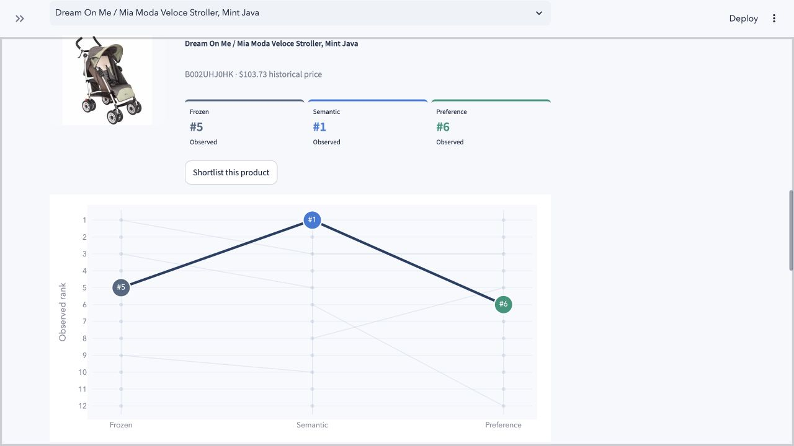
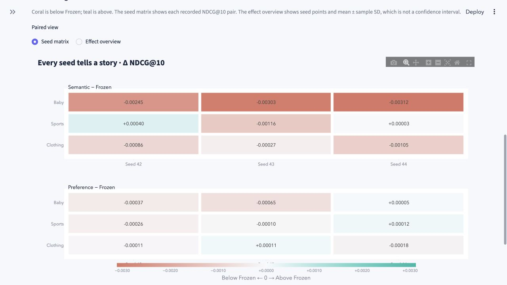

# ShopLens: Qwen objective comparison and interactive evidence

## Study overview

ShopLens compares three ways of using Qwen text embeddings for multimodal product recommendation: a frozen text encoder, semantic alignment with LoRA, and preference ranking with LoRA. The saved historical audit reports **27 complete formal records and zero audit errors**: three Amazon 2014 product domains × three objectives × three independently repeated pipeline seeds (42, 43 and 44).

**Frozen has the highest mean held-out NDCG@10 in all three domains.** The recorded study does not establish a consistent improvement from either LoRA objective. Preference training is generally closer to Frozen than semantic alignment, while several individual paired seeds reverse the mean ordering. These descriptive results are reported without a statistical-significance or online-performance claim.

The application now exposes the experiment through an interactive Experiment gallery and makes current shopping recommendations easier to inspect through Model arena. This presentation upgrade adds **no training runs and no new formal benchmark scores**. The gallery presents historical measurements; Shopping Studio is a separate exploratory free-text retrieval interaction.

The three benchmarks are domains of the **same Amazon 2014 source**, not independently sourced datasets. The prepared interactive catalog contains 47,801 products: Baby 7,037; Sports & Outdoors 18,273; Clothing & Accessories 22,491.

## Formal method and protocol

### Encoders and controlled objectives

The text model is `Qwen/Qwen3-Embedding-0.6B`, pinned to revision `97b0c614be4d77ee51c0cef4e5f07c00f9eb65b3`. Encoding uses at most 256 tokens, left padding, last-valid-token pooling and L2 normalization, with identical training/export truncation. Candidate descriptions receive no query instruction. Trainable candidates use LoRA rank 8, alpha 16 and dropout 0.05 on `q_proj` and `v_proj`. The recommendation head has 128 dimensions.

The primary contrast is an **asymmetric two-tower experiment**. Histories always use frozen base-Qwen text plus the original fixed CLIP features. Only the candidate text tower changes: frozen Qwen, semantic LoRA or preference LoRA. Candidate features must not replace history features.

| Objective | Candidate text encoder | Adaptation signal | What remains controlled |
|---|---|---|---|
| Frozen | Frozen base Qwen | BPR trains the recommendation head; Qwen weights stay fixed | Frozen history text, fixed CLIP features, head architecture and evaluation protocol |
| Semantic alignment | Qwen + LoRA | Multi-positive InfoNCE aligns review anchors with candidate descriptions; BPR text input is detached so BPR trains the head | Same warmup head, sampled cases, order and negatives within domain/seed |
| User preference | Qwen + LoRA | BPR gradients update the candidate LoRA parameters directly as well as the head | Same warmup head, sampled cases, order and negatives within domain/seed |

Target reviews never enter recommendation-history queries. Semantic anchors use frozen base-Qwen review embeddings; candidate descriptions are encoded live during adaptation. The Frozen label refers to the text encoder, **not an untrained recommendation head**.

### Seeds, budgets and checkpoint selection

Each complete pipeline is repeated independently for seeds 42, 43 and 44. Within a domain/seed, all objectives share the selected full-input warmup head, the same sampled behavioral cases and order, and the same negative arrays. Adaptation uses up to 30,000 eligible TRAIN cases with exactly matched positive reviews, over two epochs.

Adaptation epoch 1 or 2 is selected using full-catalog downstream **validation NDCG@10**. Epoch 0 and held-out test scores cannot select a checkpoint. All groups retain the established temporal split, prior-item exclusions, eligible candidate catalog and user-macro evaluation protocol. The principal reported contrast is among these three Qwen objectives under the declared budget.

Legacy MiniLM baselines used a fixed five-epoch main-ranker budget and one shared adaptation seed. Qwen uses a separately declared warmup of up to 20 epochs plus sampled adaptation and full-pipeline seeds. Differences against legacy tables therefore mix model, budget and sampling changes; they are not an isolated estimate of the LoRA objective effect. Existing baseline reports and artifacts remain separate from this comparison.

## Held-out test metrics

Means and **sample standard deviations** across the three pipeline seeds are shown in original metric units. Domains are kept separate; no cross-domain mean is used. A sample SD describes observed seed variation and is neither a confidence interval nor a significance test.

| Domain | Objective | Seeds | Recall@10 | NDCG@10 | Recall@20 | NDCG@20 |
|---|---|---:|---:|---:|---:|---:|
| baby | qwen_frozen | 3 | 0.027412 ± 0.002656 | 0.012796 ± 0.000959 | 0.042491 ± 0.001817 | 0.016589 ± 0.001039 |
| baby | qwen_preference | 3 | 0.026099 ± 0.002937 | 0.012475 ± 0.000849 | 0.041547 ± 0.002861 | 0.016357 ± 0.000882 |
| baby | qwen_semantic | 3 | 0.019995 ± 0.001775 | 0.009930 ± 0.000728 | 0.032398 ± 0.002454 | 0.013070 ± 0.000873 |
| clothing | qwen_frozen | 3 | 0.010730 ± 0.000846 | 0.005186 ± 0.000562 | 0.018709 ± 0.000847 | 0.007190 ± 0.000585 |
| clothing | qwen_preference | 3 | 0.010476 ± 0.000572 | 0.005124 ± 0.000463 | 0.018854 ± 0.000463 | 0.007227 ± 0.000375 |
| clothing | qwen_semantic | 3 | 0.009161 ± 0.000485 | 0.004460 ± 0.000384 | 0.014435 ± 0.001244 | 0.005788 ± 0.000536 |
| sports | qwen_frozen | 3 | 0.014565 ± 0.000848 | 0.007116 ± 0.000684 | 0.024839 ± 0.001840 | 0.009697 ± 0.000946 |
| sports | qwen_preference | 3 | 0.014429 ± 0.000688 | 0.007039 ± 0.000584 | 0.024675 ± 0.002447 | 0.009606 ± 0.001005 |
| sports | qwen_semantic | 3 | 0.013297 ± 0.001257 | 0.006872 ± 0.000613 | 0.020772 ± 0.001763 | 0.008745 ± 0.000547 |

## Same-seed paired changes

Differences are computed between objectives using the **same complete pipeline seed** within each domain. The public summary records paired NDCG@10 differences directly; it does not contain seed-specific absolute test scores from which to reconstruct additional test-metric distributions.

| Domain | After − before | Seeds | ΔNDCG@10 mean ± SD | Wins / ties / losses |
|---|---|---|---:|---:|
| baby | qwen_semantic − qwen_frozen | 42,43,44 | -0.002866 ± 0.000364 | 0 / 0 / 3 |
| baby | qwen_preference − qwen_frozen | 42,43,44 | -0.000322 ± 0.000349 | 1 / 0 / 2 |
| baby | qwen_preference − qwen_semantic | 42,43,44 | +0.002545 ± 0.000558 | 3 / 0 / 0 |
| sports | qwen_semantic − qwen_frozen | 42,43,44 | -0.000244 ± 0.000817 | 2 / 0 / 1 |
| sports | qwen_preference − qwen_frozen | 42,43,44 | -0.000076 ± 0.000190 | 1 / 0 / 2 |
| sports | qwen_preference − qwen_semantic | 42,43,44 | +0.000168 ± 0.000865 | 2 / 0 / 1 |
| clothing | qwen_semantic − qwen_frozen | 42,43,44 | -0.000726 ± 0.000405 | 0 / 0 / 3 |
| clothing | qwen_preference − qwen_frozen | 42,43,44 | -0.000062 ± 0.000153 | 1 / 0 / 2 |
| clothing | qwen_preference − qwen_semantic | 42,43,44 | +0.000664 ± 0.000251 | 3 / 0 / 0 |

Semantic alignment is below Frozen in mean NDCG@10 in every domain; its Sports result nevertheless has two positive paired seeds and one negative seed. Preference training is also below Frozen in each domain's mean NDCG@10, with one positive paired seed per domain. Preference is above Semantic in mean NDCG@10 in all three domains, with the exact win/tie/loss counts retained in the table.

A favorable single seed or metric does not establish a general gain. In particular, the Clothing Preference means for Recall@20 and NDCG@20 are slightly above Frozen, while its mean NDCG@10 is below Frozen. The result depends on the metric and operating point; the study does not show a consistent LoRA improvement.

## Low-interaction targets

This cohort consists of targets with **at most five distinct positive TRAIN users**, including zero. It is not a separately constructed strict cold-start test.

| Domain | Objective | Seeds | Users / targets | Recall@10 | NDCG@10 |
|---|---|---:|---:|---:|---:|
| baby | qwen_frozen | 3 | 1605 / 2694 | 0.000000 ± 0.000000 | 0.000000 ± 0.000000 |
| baby | qwen_preference | 3 | 1605 / 2694 | 0.000000 ± 0.000000 | 0.000000 ± 0.000000 |
| baby | qwen_semantic | 3 | 1605 / 2694 | 0.000000 ± 0.000000 | 0.000000 ± 0.000000 |
| clothing | qwen_frozen | 3 | 5294 / 7430 | 0.000728 ± 0.000098 | 0.000263 ± 0.000046 |
| clothing | qwen_preference | 3 | 5294 / 7430 | 0.000602 ± 0.000397 | 0.000226 ± 0.000134 |
| clothing | qwen_semantic | 3 | 5294 / 7430 | 0.000750 ± 0.000319 | 0.000255 ± 0.000116 |
| sports | qwen_frozen | 3 | 4554 / 6834 | 0.000403 ± 0.000168 | 0.000161 ± 0.000085 |
| sports | qwen_preference | 3 | 4554 / 6834 | 0.000366 ± 0.000127 | 0.000153 ± 0.000082 |
| sports | qwen_semantic | 3 | 4554 / 6834 | 0.000186 ± 0.000163 | 0.000062 ± 0.000055 |

Baby has zero observed Recall@10 and NDCG@10 for this cohort in all three groups. Sports and Clothing values are also very small. These measurements do not support a claim that either fine-tuning objective resolves cold-start or low-interaction recommendation.

## Training evidence and numerical scope

Gradient routing is checked through the recorded informative probes, at most ten, rather than measured at every training step. The recorded head and LoRA gradients support the intended routing under those probes: Frozen has no LoRA updates, semantic BPR-to-LoRA gradients are zero under the detached route, and Preference receives BPR-to-LoRA gradients.

Export numerical checks cover only the first `min(4, N)` live-Qwen candidates and one validation history. They **do not establish full-catalog live-Qwen re-encoding equality**. A separate CPU cached-feature-to-head versus serving check, when supplied, is a different test and does not rerun Qwen.

| Unit | Selected epoch | Sample / eligible | Head grad max | Total LoRA grad max | BPR→LoRA max | Candidate cache error |
|---|---:|---:|---:|---:|---:|---:|
| baby/qwen_frozen/seed42 | 1 | 30000 / 61880 | 0.846 | 0 | 0 | 1.19e-07 |
| baby/qwen_frozen/seed43 | 2 | 30000 / 61880 | 0.794 | 0 | 0 | 1.79e-07 |
| baby/qwen_frozen/seed44 | 1 | 30000 / 61880 | 0.818 | 0 | 0 | 2.09e-07 |
| baby/qwen_preference/seed42 | 2 | 30000 / 61880 | 0.846 | 0.697 | 0.697 | 0.0038 |
| baby/qwen_preference/seed43 | 1 | 30000 / 61880 | 0.794 | 0.919 | 0.919 | 0.00473 |
| baby/qwen_preference/seed44 | 1 | 30000 / 61880 | 0.818 | 0.897 | 0.897 | 0.00433 |
| baby/qwen_semantic/seed42 | 2 | 30000 / 61880 | 0.846 | 1.21 | 0 | 0.00303 |
| baby/qwen_semantic/seed43 | 1 | 30000 / 61880 | 0.794 | 1.29 | 0 | 0.0056 |
| baby/qwen_semantic/seed44 | 2 | 30000 / 61880 | 0.818 | 1.16 | 0 | 0.00383 |
| clothing/qwen_frozen/seed42 | 2 | 30000 / 114449 | 0.431 | 0 | 0 | 2.68e-07 |
| clothing/qwen_frozen/seed43 | 1 | 30000 / 114449 | 0.512 | 0 | 0 | 1.79e-07 |
| clothing/qwen_frozen/seed44 | 1 | 30000 / 114449 | 0.525 | 0 | 0 | 2.38e-07 |
| clothing/qwen_preference/seed42 | 2 | 30000 / 114449 | 0.431 | 0.647 | 0.647 | 0.00402 |
| clothing/qwen_preference/seed43 | 1 | 30000 / 114449 | 0.512 | 0.623 | 0.623 | 0.00432 |
| clothing/qwen_preference/seed44 | 2 | 30000 / 114449 | 0.523 | 0.536 | 0.536 | 0.00256 |
| clothing/qwen_semantic/seed42 | 2 | 30000 / 114449 | 0.431 | 1.69 | 0 | 0.0071 |
| clothing/qwen_semantic/seed43 | 1 | 30000 / 114449 | 0.512 | 1.42 | 0 | 0.00188 |
| clothing/qwen_semantic/seed44 | 2 | 30000 / 114449 | 0.523 | 1.13 | 0 | 0.00328 |
| sports/qwen_frozen/seed42 | 2 | 30000 / 139446 | 0.714 | 0 | 0 | 1.79e-07 |
| sports/qwen_frozen/seed43 | 1 | 30000 / 139446 | 0.768 | 0 | 0 | 2.38e-07 |
| sports/qwen_frozen/seed44 | 1 | 30000 / 139446 | 0.698 | 0 | 0 | 2.09e-07 |
| sports/qwen_preference/seed42 | 1 | 30000 / 139446 | 0.714 | 0.758 | 0.758 | 0.00337 |
| sports/qwen_preference/seed43 | 1 | 30000 / 139446 | 0.768 | 1.05 | 1.05 | 0.00404 |
| sports/qwen_preference/seed44 | 1 | 30000 / 139446 | 0.698 | 1.12 | 1.12 | 0.00423 |
| sports/qwen_semantic/seed42 | 2 | 30000 / 139446 | 0.714 | 1.1 | 0 | 0.00344 |
| sports/qwen_semantic/seed43 | 1 | 30000 / 139446 | 0.768 | 1.21 | 0 | 0.0043 |
| sports/qwen_semantic/seed44 | 1 | 30000 / 139446 | 0.698 | 0.981 | 0 | 0.00402 |

## Execution recovery and backend limits

### Result serialization recovery

For `baby/qwen_frozen/seed42`, the initial test computation finished, but saving the result failed because `torch.device` was not JSON serializable. After recording the device with `str(device)`, the unsaved evaluation was recomputed from the same selected training checkpoint. This is one persisted formal record for that selected checkpoint, not a claim that test computation never repeated. Existing persisted results are reused after subsequent interruptions.

The saved recovery note records unchanged training code and reuse of the selected training checkpoints, with no test-score selection or tuning. The changed model module was `src/shoplens/qwen_evaluate.py`. This operational recovery does not relax the 27-record or training-evidence audit requirements.

### Numerical recovery

For `clothing/qwen_semantic/seed42`, the recorded automatic-SDPA diagnostic first failed at step 69 after 68 successful updates: forward values and head gradients were finite, but LoRA gradients were nonfinite before clipping. The same clean state, batch and RNG reproduced the failure. A MATH replay and a fresh 100-step MATH diagnostic prefix remained finite. This evidence **does not establish a specific fused-kernel root cause**.

The recovery changes live CUDA candidate training to MATH SDPA and rejects nonfinite head/LoRA gradient norms before `optimizer.step`; cached encoding remains automatic. The 19 completed formal units were preserved. The failed unit restarted from initialization without a resume checkpoint. The saved record declares unchanged objective, sampling, learning rates and budget, and no test-score selection or tuning.

All six Clothing LoRA units use MATH training SDPA. Previously completed Baby/Sports LoRA units retain automatic-SDPA execution and were not required to acquire new metadata retroactively. Clothing Frozen seed42 is reused and has no LoRA training. These backend trajectories are **not asserted bitwise identical**; cross-domain differences are conditional on these numerical configurations.

The historical numerical-recovery status is complete, and both the production same-state regression and production 100-step prefix regression passed. Final completeness required that status, both gates, and all six Clothing LoRA training records declaring MATH, the nonfinite-gradient guard and automatic cached encoding. The public summary retains the recovery evidence under `verification.execution_recovery`, including its `numerical_recovery` subsection.

## Interactive evidence and presentation upgrade

### Shopping Studio and Model arena

Shopping Studio accepts a natural-language product request and an optional reference image. Each objective uses its own actual Frozen/LoRA query encoder and corresponding 1024-dimensional candidate text vectors, so text candidate pools can differ. CLIP image features are shared. Direct request retrieval requires no positive-history click; optional feedback can activate the selected objective's learned history/candidate towers and user head.

Studio retrieves its semantic candidate pool and reranks it using available image and feedback signals. Budget and exclusion filters do not refill the pool with lower-relevance products. Prices are historical USD metadata, unknown prices are excluded by a budget, and avoid terms are soft preferences. The interface does not guarantee suitability, live price or stock. None of these interactions trains a model or changes formal metrics.

**Model arena** makes the same current request's three observed Top-12 lists inspectable. It shows the union size, products shared by all three lists, and products appearing on only one list. A product selector links a real catalog photo, three observed rank badges and a focused rank trajectory. Products can be shortlisted directly from this view; the original Top-3 model cards and full rank table remain available.

One captured real-model example showed product **`B002UHJ0HK` at ranks 5 / 1 / 6** for Frozen / Semantic / Preference. That captured comparison contained **24 distinct products**, of which **2 appeared in all three lists** and **14 appeared on one list only**. These are measurements of that particular interactive state, not aggregate benchmark results or evidence that Semantic is better. Changing the request, reference, feedback or constraints can change the lists.



A missing rank remains unknown outside the observed Top-12; it is not assigned rank 13. Line gaps preserve that absence. An unavailable model is not treated as an empty recommendation list, and cross-model raw scores are not compared. Shared/unique counts and rank movement describe list composition rather than recommendation quality. The horizontal axis compares objectives, not a training timeline.

### Experiment gallery

Experiment gallery is an independent view of the validated, publicly included summary. It opens **without model weights or runtime catalogs**. The performance landscape displays each domain's three means with sample-SD whiskers, with selectors for the four reported test metrics. The paired seed matrix and effect overview use recorded NDCG@10 differences only; they do not synthesize paired Recall or NDCG@20 values.

The training view switches among seeds 42, 43 and 44, plotting the two actual adaptation validation observations for each domain/objective and marking the saved validation-selected checkpoint. Frozen keeps Qwen fixed while its recommendation head trains. No additional epochs, test points or intermediate training measurements are invented.



Figures can be saved from the browser as SVG or PNG, and the view exports self-contained interactive HTML plus the exact plotted CSV and source JSON. The offline export command builds **seven figures**: four performance-metric views, a paired-seed matrix, a paired effect overview, and a seed42 validation view. Its companion CSV/JSON files retain the broader recorded evidence, including all three seeds' training records. Plotly is embedded in the HTML, so the generated figure pack does not require a CDN or model weights to view.

```bash
python scripts/export_experiment_gallery.py --output dist/experiment-gallery
```

Open `dist/experiment-gallery/index.html` and keep the companion CSV/JSON files beside it. This command exports existing evidence; it does not train, run recommendation inference or repeat the original evaluation. Published downloadable artifacts are listed in the repository's [Releases](https://github.com/cjk041212/ShopLens/releases).

### Validation of the presentation update

The updated local source passed **296 tests and 127 subtests**. These cover evidence parsing, exact chart values, seed identities, sample-SD and paired-difference handling, checkpoint exports, Studio state boundaries and the no-runtime gallery route. Invalid or incomplete summaries produce an error instead of replacement scores. The real-model arena capture and browser interactions provide additional application evidence, separate from the automated fixtures.

These checks support software behavior and faithfulness to the recorded measurements. They are **not new recommendation-quality experiments**, do not make the historical audit a fresh full-export byte audit, and do not establish online performance gains. The original 27-run metrics, baseline results and selected training checkpoints were not changed by this upgrade.

## Audit, reproducibility and limitations

The machine-readable source is [results_qwen_summary.json](../results/qwen/results_qwen_summary.json), with the compact numeric table in [results_qwen_summary.csv](../results/qwen/results_qwen_summary.csv). The JSON contains the nine aggregate groups, nine paired comparisons, 27 unit-evidence identities, gradient/export probes and execution recovery evidence. Its declared completeness is a **historical audit result**; opening the app or exporting figures does not rerun training or verify every original checkpoint byte.

The gallery validates completeness and unique identities, finite metric values, matched seeds, paired mean/sample-SD arithmetic, cross-objective paired consistency and validation-selected checkpoints. Recorded evidence hashes identify the historical sources. Baseline byte preservation is claimed only where the separate saved verification evidence supplies it.

The runtime release selects seed42 for interaction and includes nine selected exports and six LoRA adapters. It does not contain every seed's complete checkpoint, raw review text or interaction events. Installing the runtime package or opening the summary-only gallery does not reproduce the 27 training pipelines. Full training requires separately prepared source data and compute.

Three seeds describe observed variation, not population uncertainty. A mean gain can coexist with seed-level losses; near-zero low-interaction metrics must remain visible. Domain-specific numerical-backend choices and the limited export probe scope further restrict conclusions. Formal history-to-item evaluation and exploratory free-text shopping must be assessed separately.

## Source map

This report and the presentation live under `reports/`. Code links below resolve to repository-root `src/` and `scripts/`; recorded metrics live under `results/qwen/`; image links use `reports/assets/`.

| Evidence or implementation | Repository source |
|---|---|
| Formal summary and historical audit | [results_qwen_summary.json](../results/qwen/results_qwen_summary.json) |
| Compact results table | [results_qwen_summary.csv](../results/qwen/results_qwen_summary.csv) |
| Qwen feature encoding | [qwen_text.py](../src/shoplens/qwen_text.py) |
| Training, objectives and gradient routing | [qwen_models.py](../src/shoplens/qwen_models.py), [qwen_pipeline.py](../src/shoplens/qwen_pipeline.py) |
| Formal evaluation and serialization recovery | [qwen_evaluate.py](../src/shoplens/qwen_evaluate.py) |
| Selected-checkpoint serving | [qwen_inference.py](../src/shoplens/qwen_inference.py) |
| Studio retrieval, encoders and learned-model access | [studio.py](../src/shoplens/studio.py), [studio_encoders.py](../src/shoplens/studio_encoders.py), [studio_models.py](../src/shoplens/studio_models.py) |
| Model arena and its recorded-rank chart | [studio_ui.py](../src/shoplens/studio_ui.py), [studio_charts.py](../src/shoplens/studio_charts.py) |
| Summary validation and experiment figures | [experiment_data.py](../src/shoplens/experiment_data.py), [experiment_charts.py](../src/shoplens/experiment_charts.py), [experiment_ui.py](../src/shoplens/experiment_ui.py) |
| Offline figure-pack exporter | [export_experiment_gallery.py](../scripts/export_experiment_gallery.py) |

Upstream sources: [pinned Qwen model](https://huggingface.co/Qwen/Qwen3-Embedding-0.6B/tree/97b0c614be4d77ee51c0cef4e5f07c00f9eb65b3), [Amazon 2014 original data](https://mcauleylab.ucsd.edu/public_datasets/data/amazon/datasets.html), and the [CLIP paper](https://proceedings.mlr.press/v139/radford21a.html).
